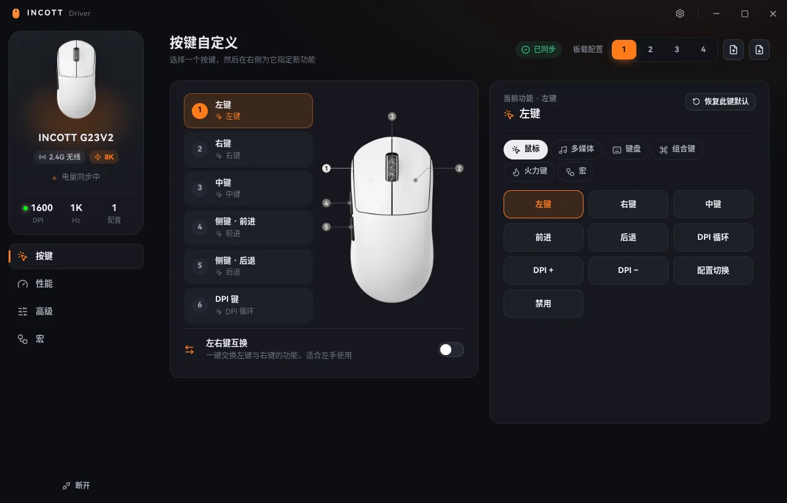
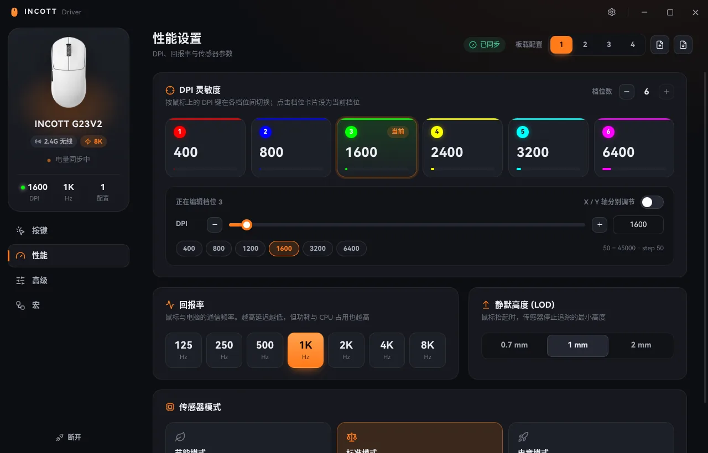
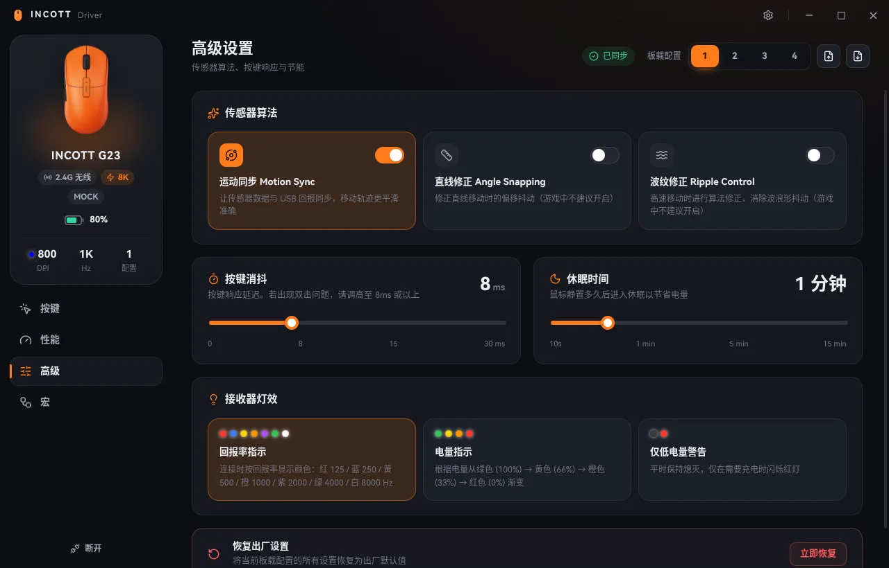
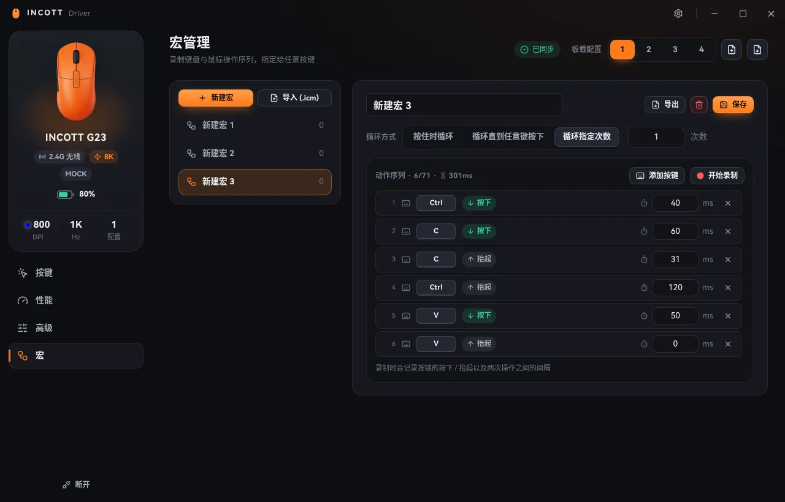

<div align="center">


# INCOTT Driver

**INCOTT 鼠标的跨平台桌面驱动**

调整 DPI、回报率、按键与宏，设置写入鼠标板载内存，关掉软件也一直生效。

[](https://github.com/oexi/incott-driver-desktop/releases/latest)
[](https://github.com/oexi/incott-driver-desktop/releases)
[](https://github.com/oexi/incott-driver-desktop/actions/workflows/release.yml)
[](LICENSE)


[**⬇ 下载**](#-下载安装) · [功能](#-功能一览) · [常见问题](#-常见问题) · [从源码构建](#️-开发)

<br />



</div>

<br />

## ✨ 亮点

<table>
<tr>
<td width="33%" valign="top">

### 🎯 与官方一致
通信协议从官方 WebHID 网页驱动逐条移植。自动化测试会直接运行**原版代码**，与本项目**逐字节对比**发往鼠标的数据。

</td>
<td width="33%" valign="top">

### 🎨 全新界面
深色 / 浅色主题、5 种强调色、中英文双语。实时显示电量、当前 DPI 和回报率，插拔自动识别。

</td>
<td width="33%" valign="top">

### 🛡️ 放心使用
首次连接先从鼠标**读取**现有映射，你修改之前不写入任何数据。完全离线，内置原版界面随时切回。

</td>
</tr>
</table>

## 📸 界面预览

<table>
<tr>
<td width="50%"><p align="center"><sub><b>性能</b> · DPI 档位 / 回报率 / 传感器模式 / LOD</sub></p></td>
<td width="50%"><p align="center"><sub><b>高级</b> · 传感器算法 / 消抖 / 休眠 / 接收器灯效</sub></p></td>
</tr>
<tr>
<td width="50%"><p align="center"><sub><b>宏</b> · 录制键鼠操作，精确编辑延迟</sub></p></td>
<td width="50%"><p align="center"><sub><b>浅色主题</b> · 也可跟随系统自动切换</sub></p></td>
</tr>
</table>

## 🧩 功能一览

| | 功能 |
|:---:|---|
| 🖱️ **按键** | 6 个按键自定义：鼠标功能、DPI 循环 / ±、配置切换、禁用、16 种多媒体键、任意键盘键、组合键（Ctrl / Shift / Alt / Win）、火力键（间隔 + 连发次数）、宏<br />左右键一键互换，并保护"至少保留一个左键" |
| ⚡ **性能** | 1–6 档 DPI，步进 50，X / Y 轴可分离（PAW3395 最高 32000，PAW3950 最高 45000，范围与官方一致）<br />回报率 125 – 8000 Hz（2000 Hz 以上需要 8K 接收器）· 传感器模式（节能 / 标准 / 电竞）· LOD 静默高度 |
| 🔧 **高级** | Motion Sync · 直线修正 · 波纹修正 · 按键消抖 0–30 ms · 休眠时间 · 8K 接收器灯效 · 恢复出厂设置 |
| ⏺️ **宏** | 录制键盘与鼠标按键及间隔，手动修改按键 / 按下抬起 / 延迟，三种循环方式，最多 71 个动作 |
| 💾 **配置** | 4 个板载配置，兼容官方 `.ict` 配置文件与 `.icm` 宏文件的导入导出 |
| 🔌 **设备** | 自动识别与热插拔，电量与充电状态，DPI / 回报率与鼠标实时同步 |

**支持型号**：G23 · G24 · G23V2 · 零29 · 零39 · Ghero · FM23（与官方网页驱动相同）

## 📦 下载安装

前往 **[Releases 页面](https://github.com/oexi/incott-driver-desktop/releases/latest)** 下载对应文件：

| 系统 | x64（Intel / AMD） | arm64 |
|---|---|---|
|  | `win-x64-setup.exe` 安装版<br />`win-x64-portable.exe` 免安装版 | `win-arm64-setup.exe`<br />`win-arm64-portable.exe` |
|  | `mac-x64.dmg` | `mac-arm64.dmg`（M 系列芯片） |
|  | `.AppImage` · `.deb` · `.rpm` · `.pacman` · `.tar.gz` | 同上（文件名含 `arm64` / `aarch64`） |

<details>
<summary><b>🍎 macOS：提示"已损坏"或"无法验证开发者"</b></summary>

<br />

应用没有 Apple 开发者证书（仅 ad-hoc 签名），把应用拖进"应用程序"后，在终端执行一次：

```bash
xattr -cr "/Applications/Incott Driver.app"
```

</details>

<details>
<summary><b>🐧 Linux：设备权限（udev 规则）</b></summary>

<br />

普通用户访问 `/dev/hidraw*` 需要 udev 规则：

- **deb / rpm / pacman**：安装时自动放入 `/usr/lib/udev/rules.d/70-incott-mouse.rules`
- **AppImage / tar.gz**：首次运行若权限不足，界面会出现「一键安装 udev 规则」按钮（通过 `pkexec` 授权）

安装后重新插拔接收器即可。也可以手动安装：

```bash
sudo cp build/linux/70-incott-mouse.rules /etc/udev/rules.d/
sudo udevadm control --reload-rules && sudo udevadm trigger
```

</details>

## ❓ 常见问题

<details>
<summary><b>第一次打开，DPI 数值和我设置的不一样？</b></summary>

<br />

鼠标只能读回按键映射和 DPI 档位数，DPI 具体数值、消抖等参数读不出来，所以首次使用时先显示默认值。**在你修改之前，软件不会向鼠标写入任何数据。**

想完整沿用网页驱动里的设置：在网页驱动里导出 `.ict` 文件，再点本软件右上角的「导入」按钮。

</details>

<details>
<summary><b>板载配置是怎么工作的？</b></summary>

<br />

与官方逻辑一致：切换配置时，会把该配置的全部设置写入鼠标。按鼠标上的「配置切换」键时，需要软件正在运行才能同步。如果经常用这个键，可以在设置里开启「关闭窗口时最小化到托盘」。

</details>

<details>
<summary><b>提示「设备被占用」或连接不上？</b></summary>

<br />

同一时间只能有一个程序控制鼠标。请先关闭浏览器里的官方网页驱动，再重新插拔接收器后重试。

</details>

<details>
<summary><b>想用回原来的界面？</b></summary>

<br />

设置 → 经典界面 → 「打开经典界面」，会打开内置的官方网页驱动界面，配置数据与新界面共用。

</details>

## 🛠️ 开发

需要 Node.js 20+。

```bash
npm install
npm run dev          # 开发模式（Vite 热更新 + Electron）
npm test             # 协议差分测试
npm run web          # 浏览器预览界面，打开 http://localhost:5178/?mock 使用模拟设备
```

<details>
<summary><b>打包</b></summary>

<br />

```bash
npm run dist:linux   # Linux x64 + arm64
npm run dist:win     # Windows x64 + arm64
npm run dist:mac     # macOS x64 + arm64（需在 macOS 上执行）
```

</details>

<details>
<summary><b>发布新版本</b></summary>

<br />

推送 `v*` 标签即可触发 GitHub Actions：测试 → 6 个平台 / 架构并行打包 → 自动创建 Release，并附上全部安装包和 `SHA256SUMS.txt`。

```bash
npm version patch && git push --follow-tags
```

</details>

<details>
<summary><b>项目结构</b></summary>

<br />

```
electron/            主进程：窗口、WebHID 授权与设备选择、托盘、文件对话框、Linux udev
src/protocol/        协议层（移植自原版 CBAccess / StProfile / STMacro）
  device.js          HID 收发、读取设备信息、apply() 写入流程
  profile.js         板载配置（.ict 文本格式）
  macro.js           宏（.icm 文本格式、320 字节硬件缓冲区）
  constants.js       功能码、DPI 表、回报率等常量
src/store.js         业务逻辑（配置切换、按键校验、写入队列…）
src/pages/           按键 / 性能 / 高级 / 宏 页面
classic/             官方网页驱动（经典界面，同时作为差分测试的基准）
tests/               差分测试：沙箱运行原版代码，与移植版逐字节比对 HID 报文
```

</details>

<details>
<summary><b>协议说明</b></summary>

<br />

所有命令都是 Report ID 9 的 8 字节 Feature Report。读取时先发送命令，等待 25 ms 后调用 `receiveFeatureReport`，回包第 1 字节是命令回显。宏数据先发 Feature 头 `[7, 10, i, 32, 按键号]`，再通过 Output Report 分 10 包、每包 32 字节下发。

| 写入 | 含义 | 读取 | 含义 |
|---|---|---|---|
| `1` | 回报率 | `143` | 型号 / 接收器 / 传感器 |
| `2` | DPI 档位数值（X / Y） | `142` | 配对状态 |
| `3` | DPI 档位数与当前档 | `137` | 设备信息 |
| `4, 1…5` | LOD / 波纹 / 直线 / Motion Sync / 传感器模式 | `131` | 档位数与当前档 |
| `5, 1…3` | 消抖 / 火力键参数 / 休眠 | `134` | 按键映射（`134, 9` 为当前板载配置） |
| `6` | 按键映射（`6, 9` 切换板载配置） | `133` | 无线信号 |
| `7` | 宏数据头 | | |
| `8` | 接收器灯效 | | |

</details>

## 📄 许可证

本项目自有代码以 **[MIT 协议](LICENSE)** 开源。以下第三方内容**不适用** MIT 协议，版权归各自所有者（详见 [NOTICE](NOTICE)）：

| 路径 | 内容 | 版权 / 协议 |
|---|---|---|
| `classic/` | 官方网页驱动离线镜像 | © INCOTT（因科特） |
| `public/mice/` · `public/products/` | 鼠标产品图 | © INCOTT（因科特） |
| `src/assets/fonts/` | HarmonyOS Sans 字体 | © 华为，HarmonyOS Sans Fonts License |

> [!NOTE]
> 本项目是非官方第三方工具，与 INCOTT（因科特）无关联。使用本软件修改鼠标设置的风险由使用者自行承担。

<div align="center">
<sub>如果这个项目对你有帮助，欢迎点个 ⭐</sub>
</div>
